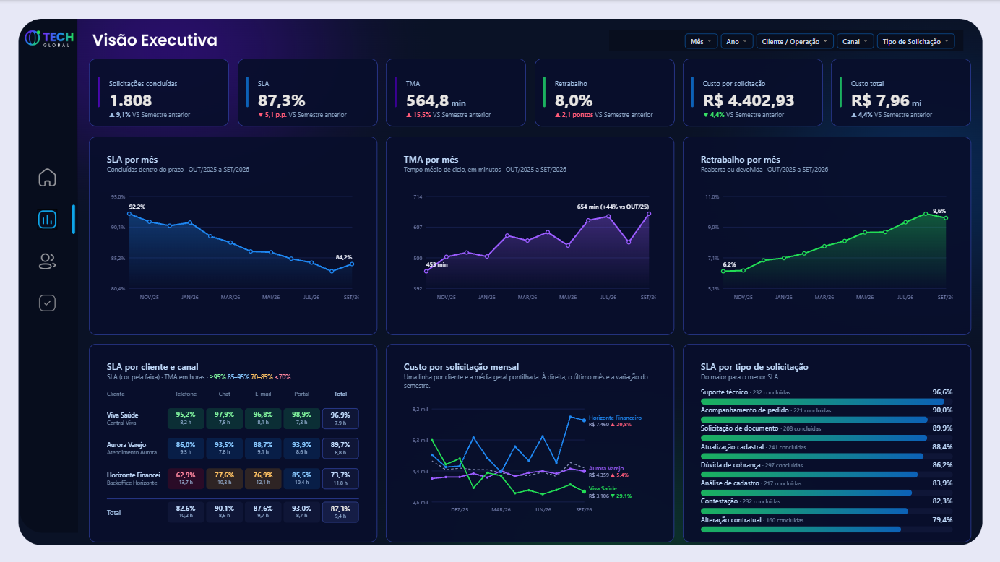
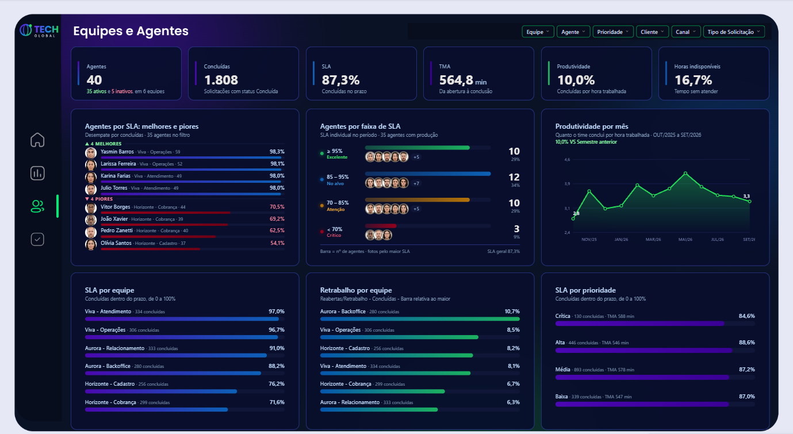
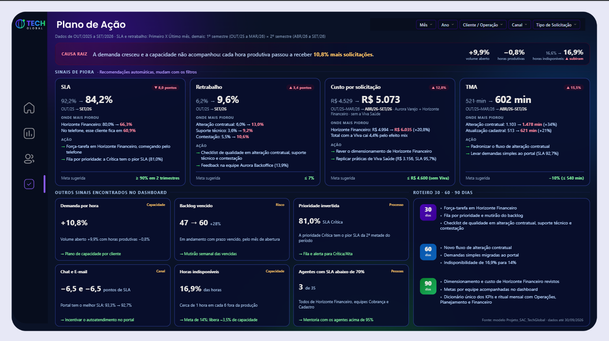

# 🎧 SAC Tech Global | SQL Server & Power BI

  

> 🔓 **Relatório interativo aberto**, sem login: clique no botão acima. Todos os dados são fictícios.

## 📌 Sobre o Projeto

Projeto de portfólio que analisa a operação de SAC da **Tech Global**, uma empresa fictícia que atende três clientes: Aurora Varejo, Horizonte Financeiro e Viva Saúde. A base cobre **12 meses (OUT/25 a SET/26)**, com **2.000 solicitações**, das quais **1.808 foram concluídas**.

O objetivo foi responder a uma pergunta de negócio: **a operação piorou no último semestre? Onde, por quê e o que fazer?** O dashboard leva o usuário do diagnóstico ao plano de ação em quatro páginas.

## 🎯 Principais Resultados

| Indicador | Resultado | Base de comparação |
|:--|:--:|:--|
| **SLA** | 92% → 84% | Primeiro mês contra último mês (por semestre: 90% → 85%) |
| **TMA** | +16% | 1º semestre contra 2º semestre |
| **Custo por solicitação** | +12% | 1º contra 2º semestre, sem a Viva Saúde (efeito mix) |
| **Retrabalho** | 6% → 10% | Primeiro mês contra último mês |

- A piora se concentra no cliente **Horizonte Financeiro** (SLA de 87% para 69%) e no canal **Telefone**.
- A demanda por hora produtiva subiu **11%**, enquanto as horas indisponíveis ficaram estáveis em cerca de **17%**. A carga aumentou sem que houvesse menos gente disponível.
- Os 4 agentes com pior SLA são todos da operação Horizonte Financeiro.

## 🏗 Arquitetura de Dados e Modelagem

**Fluxo:** planilha Excel → SQL Server (esquema `dw`) → Power BI (modo Import) → medidas DAX → visuais HTML/SVG.

O modelo segue um **esquema estrela** com três tabelas fato, cada uma na sua granularidade:

| Tabela | Tipo | Granularidade |
|:--|:--:|:--|
| `fato_solicitacao` | Fato | Uma solicitação por linha |
| `fato_custo` | Fato | Custo por operação e mês |
| `fato_apontamento` | Fato | Horas produtivas e indisponíveis por agente, operação e data |
| `dim_calendario` | Dimensão | Data |
| `dim_operacao` | Dimensão | Cliente e operação |
| `dim_agente` | Dimensão | Agente, equipe e supervisor |
| `dim_canal` | Dimensão | Canal de atendimento |
| `dim_tipo_solicitacao` | Dimensão | Tipo de solicitação |

- A `fato_solicitacao` tem **duas datas** ligadas ao calendário: a de conclusão (relação ativa) e a de abertura (relação inativa, ativada só nos indicadores contados pela data de abertura, como o volume aberto).
- Todas as medidas ficam em uma tabela própria (`_Medidas`), organizadas em pastas por página.

## 📐 Indicadores e Premissas

O dashboard trabalha com **12 KPIs**, entre eles SLA, TMA, retrabalho, custo por solicitação, produtividade, backlog vencido e horas indisponíveis. Algumas premissas foram definidas para evitar números que a base não sustenta:

- **Sem rateio de custo:** a base traz o custo por cliente e mês, sem regra de divisão por canal, tipo, prioridade ou agente. Nesses filtros, o custo fica em branco, com um aviso na tela, em vez de mostrar uma divisão inventada.
- **Semestre contra semestre:** as variações dos cards comparam os últimos 6 meses com os 6 anteriores, porque um mês isolado oscila muito. O período comparado aparece em cada card.
- **Efeito mix:** a Viva Saúde aumentou em 43% as solicitações concluídas com o custo praticamente parado, o que puxa a média do custo por solicitação para baixo. Por isso ela sai **apenas** do cálculo de custo do Plano de Ação.
- **KPIs neutros:** concluídas e custo total aparecem em cinza. Mais volume pode significar mais entrega ou só mais demanda, e o custo total pode subir apenas por acompanhar o volume.
- **Tendências, não níveis:** os valores absolutos da base parecem uma amostra. Por isso, a análise destaca variações e porcentagens.

## 🛠 Tecnologias e Ferramentas Utilizadas

- **SQL Server:** armazenamento e modelagem dimensional (esquema `dw`)
- **Power BI Desktop (PBIP):** modelo semântico e relatório em formato de projeto, versionável no Git
- **Power Query:** conexão e carga das tabelas
- **DAX:** cálculos dos KPIs e geração do HTML/SVG dos visuais
- **HTML Content (visual personalizado):** cards, gráficos e páginas montados em HTML e SVG a partir de medidas DAX
- **Figma:** layout e plano de fundo das páginas

## 📊 Estrutura do Dashboard

### Visão Geral das Páginas

| Início | Visão Executiva |
|:--:|:--:|
|  |  |

| Equipes e Agentes | Plano de Ação |
|:--:|:--:|
|  |  |

- **Início:** os três números principais e o acesso à análise.
- **Visão Executiva:** os KPIs com variação semestral, a evolução mensal de SLA, TMA e retrabalho, e os cortes por cliente, canal e tipo.
- **Equipes e Agentes:** desempenho por equipe, prioridade e agente, com ranking de melhores e piores.
- **Plano de Ação:** os pontos de piora, onde eles se concentram, a causa provável e um roteiro de 30, 60 e 90 dias.

## 💡 Funcionalidades e UX/UI Aplicadas

- **Visuais gerados por DAX:** cards e gráficos são escritos em HTML e SVG dentro das medidas, o que dá controle total sobre o layout sem depender dos visuais padrão.
- **Recomendações automáticas:** o Plano de Ação escolhe sozinho o pior cliente, os tipos com maior alta de TMA e retrabalho e o canal com melhor SLA. Com filtros, os números, os textos e o roteiro mudam juntos.
- **Ranking inteligente de agentes:** sem filtro, mostra os 4 melhores e os 4 piores. Com agentes selecionados, mostra a posição de cada um entre todos (por exemplo, "32º de 35") e a faixa em que ele está.
- **Bases de comparação explícitas:** cada variação diz o que está comparando (semestre contra semestre ou primeiro contra último mês), em pontos percentuais (p.p.) quando o indicador já é uma porcentagem.
- **Avisos no lugar de números sem base:** quando um filtro impede um cálculo confiável, o visual explica o motivo em vez de exibir um valor enganoso.

---

Desenvolvido por **Lucas Oliveira** · [LinkedIn](https://www.linkedin.com/in/lucas-santos-social/)
